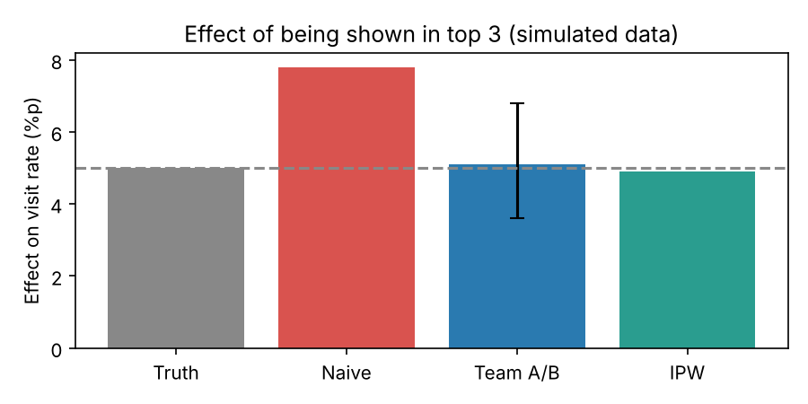

# 여의도 회사 맛집 추천

**사이트 바로가기: https://yeouido-matjip.streamlit.app**

AI 데이터분석 수업 개인 프로젝트입니다. 여의도역 인근 회사 직원이 **점심/저녁 → 자리(편한 외식·팀 회식·외부 미팅 등) → 메뉴**를 고르면, 회사 반경 1km 식당을 조건과 점수로 추천합니다.

## 진행 과정
| 단계 | 내용 | 파일 |
|---|---|---|
| 1. 데이터 수집 | 카카오 로컬 API로 식당 1,343곳 수집 | [01_데이터수집](notebooks/01_데이터수집.ipynb) |
| 2. 데이터 보강 | 구글 Places API로 별점·가격대·단체·예약 정보 추가 | [01c_구글별점](notebooks/01c_구글별점.ipynb) |
| 3. 탐색 | 메뉴·거리 분포, 식당 밀집 패턴 확인 | [02_탐색](notebooks/02_탐색.ipynb) |
| 4. 추천 사이트 | 조건 필터 + 보정 별점 + 목적 가산점, Streamlit | [app/](app/) |
| 5. 인과분석 | 추천 상단 노출 효과를 가상 실험으로 검증 (단순 비교 vs A/B vs IPW) | [05_인과분석](notebooks/05_인과분석.ipynb) |



## 사이트 실행
```bash
pip install -r app/requirements.txt
streamlit run app/app.py
```
Colab에서는 [03_추천사이트_실행](notebooks/03_추천사이트_실행.ipynb)을 위에서부터 한 칸씩 실행하면 사이트 주소가 나와요.

데이터: 식당 정보는 카카오·구글 공식 API(실제), 직원 리뷰는 예시, 인과분석은 가상 데이터입니다.
